# SPARC Studio user guide

SPARC Studio is a local web app for the SPARC urban-heat pipeline (`sparc/core`, stages S0–S7 plus the post-run studies). It takes you from a CSV of street-level temperatures to cooling decisions you can defend and export. While it works it always tells you what the machine is doing, how long it will take, what it has already produced, and whether an interrupted run can be picked up where it stopped.

Studio runs on your own computer. There are no accounts and nothing is uploaded anywhere: the server listens on `127.0.0.1`, and the browser is just its window.

This guide is task-oriented. The exact behaviour is specified in [`SPEC.md`](SPEC.md) and the HTTP contract in [`api.md`](api.md); [`DEVELOPING.md`](DEVELOPING.md) is for people changing Studio itself, and [`RELEASE_NOTES.md`](RELEASE_NOTES.md) lists what this release changed in the core pipeline. The screenshots come from the end-to-end test runs (`tests/studio/e2e/`, mostly on the synthetic demo city, so their numbers are small and synthetic) and from the milestone checks run with the same harness.

**Contents**

1. [Install and launch](#1-install-and-launch)
2. [The workspace](#2-the-workspace)
3. [Finding your way around](#3-finding-your-way-around)
4. [Walkthroughs](#4-walkthroughs): J1 tour without data · J2 a new city · J3 overnight run · J4 cancel and relaunch · J5 explore a run · J6 district scenario · J7 budget plan · J8 validation dossier · J9 reproduce and compare · J10 bring existing work in
5. [Tracking runs and jobs](#5-tracking-runs-and-jobs)
6. [Outputs and exports](#6-outputs-and-exports)
7. [Scenario Lab](#7-scenario-lab)
8. [Studies](#8-studies)
9. [Settings, thread budget and memory](#9-settings-thread-budget-and-memory)
10. [Troubleshooting](#10-troubleshooting)

Two words are used throughout:

- **Quick estimate** (technically the *emulator preview*: a linear emulator built from the run). It answers in about a tenth of a second while you edit, but it never levels off, never keeps changes within observed conditions and carries no likely range. It is always labelled.
- **Full model** (technically the *exact engine*: the run's own fitted models). **Run full model** takes seconds (a fast run) to tens of seconds (a full run), and gives a likely range. Uncertainty, comparisons, impacts and decision packs come only from full-model results.

**Plain words, precise meanings.** Studio is written for city planners. Labels use plain words ("Accuracy score", "Typical error", "Likely range", "Place" for a grid cell); the precise or technical meaning is one hover, tap or keyboard focus away, in the ⓘ next to a label or the dotted underline of a term (for example *Accuracy score* → R², held-out, cross-validated). The same words are used everywhere, from one shared glossary (`sparc/core/glossary.json`) that the standalone results page reads too. This guide uses Studio's labels and gives the technical name in brackets where it helps.

---

## 1. Install and launch

### Requirements

- Python 3.11 (3.10 also works), on Windows, macOS or Linux. Python 3.12 and newer are not supported yet: the pinned causal-inference packages (dowhy 0.11, numba < 0.61) have no releases for them. If `py -3.11` says "No suitable Python runtime found", install 3.11 first (`winget install -e --id Python.Python.3.11`, or the 3.11 installer from python.org) and open a new PowerShell window. CI runs the full journey (`python -m sparc.studio.selfcheck`) and the test suites on all three.
- Memory: on Providence a fast run peaks at about 1.1 GB, a coarse 60 m run at about 1.6 GB and a full run at 30 m (54,701 cells) at about 4 GB; the Scenario Lab keeps 1.6–2.5 GB per loaded full run. Launch estimates the peak and will not start a run when the estimate plus 1 GB is more than the memory free at that moment ("Blocks the launch · needs about … GB of memory"): close other programs (browser tabs, Docker/WSL) and reload the page, or choose Fast or Coarse. 8 GB of RAM is enough for one full run at a time; 16 GB is comfortable.
- Disk: a full run with its checkpoint is about 0.6 GB.
- A current browser (Chromium, Firefox or Safari). Node is **not** needed: the web app ships pre-built inside the package.

### Install on your own machine (step by step)

Use a fresh virtual environment so Studio's packages do not clash with anything else. Torch is installed first from the CPU-only index: it is smaller and SPARC does not need a GPU.

**Windows** (PowerShell, from the folder where you cloned the repository):

```powershell
py -3.11 -m venv .venv
.venv\Scripts\Activate.ps1          # if scripts are blocked: Set-ExecutionPolicy -Scope CurrentUser RemoteSigned
python -m pip install --upgrade pip
pip install torch --index-url https://download.pytorch.org/whl/cpu
pip install -e ".[studio]"
python -m sparc.studio.selfcheck    # about 2-5 minutes; every step should say PASS
sparc studio                        # opens Studio in your browser
```

**macOS / Linux** (Terminal):

```bash
python3.11 -m venv .venv
source .venv/bin/activate
python -m pip install --upgrade pip
pip install torch                   # Linux: add --index-url https://download.pytorch.org/whl/cpu for the CPU build
pip install -e ".[studio]"
python -m sparc.studio.selfcheck    # about 2-5 minutes; every step should say PASS
sparc studio
```

`python -m sparc.studio.selfcheck` starts a real server in a throw-away folder and runs the core journey through it: the synthetic demo project, a fast run cancelled mid-fit and resumed from its checkpoint, the Scenario Lab engine, an exact scenario, a decision pack, and a clean shutdown with no processes left behind. If a step fails it prints why and keeps the folder (with `server.log`) so you can look; `--keep` keeps it either way and `-v` prints the full server log.

Next time, activate the environment (`.venv\Scripts\Activate.ps1` on Windows, `source .venv/bin/activate` elsewhere) and run `sparc studio`. Your projects live in the workspace folder (`~/sparc-studio` by default, see §2), not in the repository, so updating the code never touches them.

### Install

From PyPI:

```bash
pip install "sparc[studio]"
```

From a checkout of this repository (the usual case while Studio is new):

```bash
pip install -e ".[studio]"
```

The `studio` extra adds FastAPI, uvicorn, threadpoolctl and httpx to the core pipeline's dependencies. Without it, `sparc studio` prints the install hint and exits with status 2.

Check the installation:

```bash
# runnable
sparc studio --version
sparc studio --help > /dev/null
python -c "import fastapi, uvicorn, threadpoolctl, httpx; print('the studio extra is installed')"
```

### Launch

```bash
sparc studio
```

The terminal prints the workspace and a one-time link, then opens your browser on it:

```text
SPARC Studio 1.0.0 - workspace /home/you/sparc-studio
Open http://127.0.0.1:8765/auth?t=Qm3…
```

The link exchanges the printed token for a session cookie, so keep the terminal open but do not share the link. A new token is made at every launch. If Studio is already running for the same workspace, `sparc studio` prints that server's link and opens it instead of starting a second server.

`sparc studio`, `sparc core studio …`, `python -m sparc.studio …` and `python -m sparc.core studio …` are the same command.

| Option | What it does |
|---|---|
| `--workspace DIR` | Use another workspace (default `$SPARC_STUDIO_HOME`, else `~/sparc-studio`) |
| `--port N` | Port (default 8765). `--port 0` picks a free one; a busy port falls back to a free one, and the occupant is never touched |
| `--no-browser` | Do not open a browser; the link is printed |
| `--token T` | Use a fixed access token instead of a new one (scripts, development) |
| `--host H` and `--allow-remote` | Listen on another address. A non-loopback address needs `--allow-remote`, and then anyone with the link can use Studio |
| `--public-host H` | Accept another `Host` header, e.g. the name of an SSH tunnel or a reverse proxy |
| `--reindex` | Rebuild the workspace index from the files before starting ([§10](#the-index-looks-wrong)) |
| `--stop-jobs-on-exit` | Cancel running jobs when the server stops (by default they keep running and are picked up at the next start) |
| `--log-level` | `debug`, `info` (default), `warning` or `error` |
| `--dump-openapi PATH` | Write the API description and exit (for developers) |

### Stopping

Press Ctrl-C in the terminal. **Running jobs keep running**: each one is a separate process, and the next `sparc studio` reattaches to it and follows it to the end. To stop them as well, start Studio with `--stop-jobs-on-exit`.

### Running without a desktop: servers, containers and scripts

On a remote machine, start Studio without a browser and with a token you choose, then open the printed link through an SSH tunnel (`ssh -L 8765:127.0.0.1:8765 host`). Scripts can call the same API with `Authorization: Bearer <token>`; the HTTP contract is [`api.md`](api.md). This example starts a server on a free port, reads its address from the workspace lock file, turns on offline mode, lists the workspace and stops the server again:

```bash
# runnable
WS="${SPARC_STUDIO_HOME:-$HOME/sparc-studio}"
TOKEN=my-secret-token
sparc studio --no-browser --port 0 --token "$TOKEN" &
# studio.lock.json names the server's URL once the port is bound; wait until it answers
for i in $(seq 1 90); do
  URL=$(python -c 'import json, sys; print(json.load(open(sys.argv[1]))["url"])' "$WS/studio.lock.json" 2>/dev/null) \
    && curl -sf "$URL/api/health" > /dev/null && break
  sleep 1
done
echo "Open $URL/auth?t=$TOKEN in a browser"
curl -fsS -H "Authorization: Bearer $TOKEN" "$URL/api/system"; echo
curl -fsS -X PUT -H "Authorization: Bearer $TOKEN" -H "Content-Type: application/json" \
  -d '{"offline": true}' "$URL/api/settings"; echo
ls "$WS"
curl -fsS -X POST -H "Authorization: Bearer $TOKEN" -H "Content-Type: application/json" -d '{}' "$URL/api/shutdown"; echo
wait
```

`POST /api/shutdown` with `{"stop_jobs": true}` also cancels running jobs.

---

## 2. The workspace

Everything Studio makes lives in one folder, the **workspace**: `~/sparc-studio` unless you set `$SPARC_STUDIO_HOME` or pass `--workspace`. You can keep several workspaces (one per client, say); each has its own server, lock and token.

```text
studio.sqlite            the index (rebuildable from the files with --reindex)
studio.lock.json         which server serves this workspace: pid, port, URL (owner-only)
token                    the current access token (owner-only)
cache/                   downloads shared by every project: CMIP6 catalogue, GHCN and ISD files, station index
engine/                  the scenario engine's process info and log (host.json, host.log)
jobs/<job id>/           one folder per job: job.json, state.json, events.jsonl, stdout.log, stderr.log, result.json
projects/<slug>/
  project.json           name, template, report details, headline scenario, cost model
  config.yml             the pipeline configuration (relative paths resolve here)
  data/                  uploaded tables
  inputs/                forcing, climate, layers, features fetched for this project
  runs/<run id>/         each run's own folder (the pipeline's run directory, plus studio/ inside)
  studies/<study id>/    study outputs; study child runs under children/
  exports/<export id>/   every bundle, pack, report and page you export
  scenarios/  findings/  durable copies of your scenarios and findings
imports/<run id>/studio/ Studio's side folder for runs imported in place from elsewhere
```

The rules that keep your work safe:

- **A run folder is the source of truth.** Studio only ever writes its own `studio/` sub-folder inside a run; pipeline files change only through the pipeline. Every run launched from Studio gets its own folder (`20261002-154533-fast-9677`), so nothing is ever overwritten.
- **Imported runs stay where they are.** Importing a folder registers it in place; deleting it from Studio removes only the index entry unless you ask for the files to go too.
- **The database is an index.** If `studio.sqlite` is lost or damaged, `sparc studio --reindex` rebuilds runs, jobs, studies, scenarios, results, plans, findings and exports from the files. Only settings, config history, saved regions and uploaded selection masks live in the database alone.
- **Disk use** is shown in Settings → Storage, per run (outputs and checkpoint), per study and per cache. Deleting a checkpoint frees most of a run's space; the outputs stay viewable, but the run can no longer be resumed or opened in the Lab.

---

## 3. Finding your way around

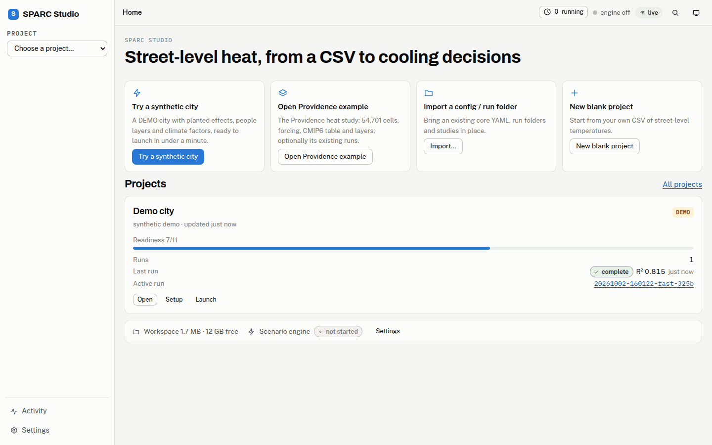

- **Left sidebar.** The project switcher, then the project's pages: **Overview** (Set up → Run → Explore → Report) · **Set up** (Data · What you can change · Weather & physics settings · More data · Scenarios · Extra checks · About, then Launch) · **Runs** · **Scenario Lab** · **Reports** (Reports & exports · Notes). A collapsed **Advanced** group holds Studies, the Config editor and Activity (all jobs); Settings sits at the bottom. Scenario Lab stays greyed out until the project has a run with saved models (a checkpoint).
- **Top bar.** Breadcrumb; the active run chip ("name · date", with a dot for its trust grade) and a run switcher; the **job tray** (running and queued jobs, click to open one); the **full-model dot** ("Full model ready", "Full model loading 42%", "Full model busy"; its tooltip says what each state means); the **connection pill** (live, reconnecting, or polling when live updates are blocked); search, i.e. the **command palette**; and the theme switch (system, light, dark).
- **Command palette** (Ctrl-K or Cmd-K): jump to a project, run, job, layer or scenario, or start an action.

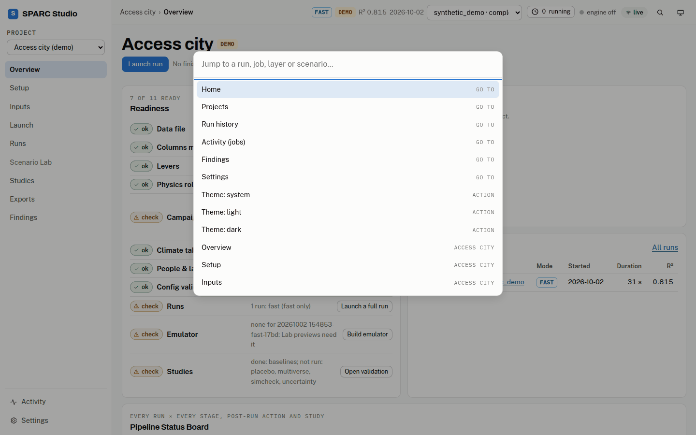

- **Everything is in the URL.** Project, run, tab, map layer, selection, compare items: copy the address and it reopens exactly that view. Reloading a page never loses your place.
- **The browser tab title** follows the most important running job (`▶ 42% S2_S3 · SPARC Studio`).
- **Honest numbers.** Every number carries its unit and sign ("cooler", "warmer") and, where there is one, its likely range; places beyond measured conditions are hatched ("Less certain here"); outputs a run does not have say which stage or study would produce them and offer a button for it; out-of-date files are badged. Projects built on the synthetic city carry a **DEMO** badge on every page.
- **Tooltips.** An ⓘ or a dotted underline explains a label: hover it, tap it, or Tab to it; Escape closes it. Studio never relies on the browser's own hover titles.
- **Keyboard.** Every control is reachable with Tab. On a map, the arrow keys move a cursor from place to place (Shift moves ten), Enter pins the place and a screen reader hears its values.

---

## 4. Walkthroughs

Each walkthrough is one of the ten user journeys Studio was designed around (SPEC §2). The end-to-end tests walk J1, the setup pages of J2, J4, J5, J6 and the plan steps of J7 on every change, and a placebo study (J8) and the Providence example (J10) every night.

### J1 — Ten-minute tour with no data

1. Install and run `sparc studio` ([§1](#1-install-and-launch)).
2. On **Home**, choose **Try a synthetic city**. Studio writes a demo project: a synthetic temperature table with planted cooling effects (`data/city.csv` and its `truth.json`), DEMO people and land-cover layers, a DEMO CMIP6-style climate table and a ready-to-run `config.yml`, all placed at a fictional location (UTM zone 19N, EPSG:32619) so maps have coordinates. This takes about a second.
3. The project **Overview** opens. Its readiness list shows what is ready and what is missing, each row with a one-click remedy. A demo project is ready to launch; the weather inputs (campaign forcing) show "check" because the demo uses generic radiation.

   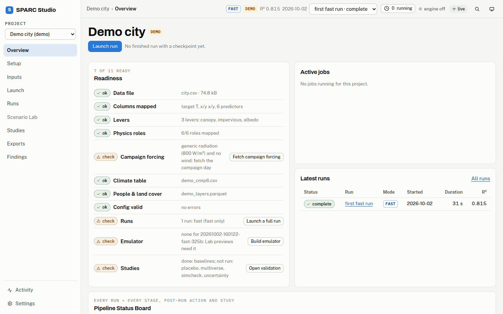

4. Click **Launch first run**. Launch preselects **Fast** and shows, for each mode, the expected time, the memory needed and the size of the saved models on *this* machine, the steps that will run ("Cause checks" will run because the demo checks canopy causally; each step's tooltip gives its stage code, here S6) and the plan graph with a time per step.

   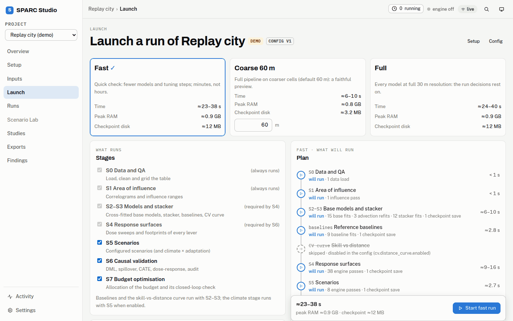

5. **Start fast run** opens **Mission Control**. The step rail advances (Check the data → Measure reach → Train the models → … → Write the report), the timeline grows, the test-area × model grid fills in, the cooling-by-amount curves draw point by point and the scenario feed lists the run's set-up scenarios as they finish ([§5](#5-tracking-runs-and-jobs)).

   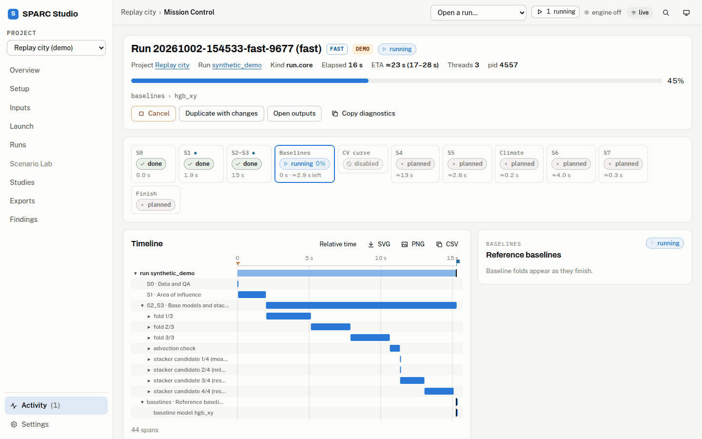

6. You do not have to wait: the run's **How much to trust this** tab (and **Model details › Accuracy**) works as soon as `predictions.parquet` is written, while later stages are still running (the view says it is live).

   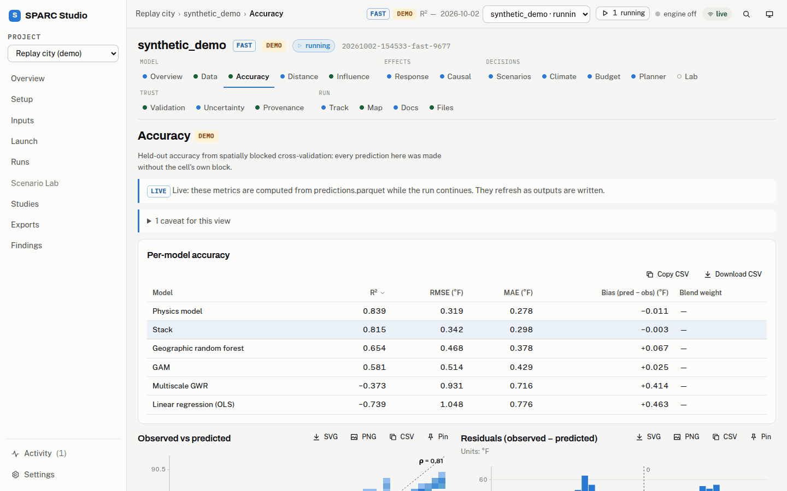

7. When the run succeeds, the overview's primary button becomes **Open Scenario Lab**. In the Lab, **Start from an example** such as **Shade the hottest 10%**. The quick estimate appears almost at once.
8. **Run full model**. The model loads (a couple of seconds for a fast run), the test areas tick (three on a fast run) and the answer card reads in plain language, for example "Cools the places you changed", a big number (−0.41 °F) on a likely-range strip (−0.52 to −0.30 °F), the chip "Confident it cools", and the citywide change, residents and cost underneath ([§7](#7-scenario-lab)).
9. Open **How much to trust this**. Because the city is synthetic, its **Independent checks** include a **Truth vs recovered** card that compares the planted effects with what the run recovered (each row says whether the run recovered the truth within 20%, under-estimated it or overstated it, with the share recovered; a run without a simulation check does not claim a share in its caveats).
10. Back in the Lab result, **Export decision pack**; it appears in **Reports** with a download link ([§6](#6-outputs-and-exports)).

### J2 — A new city from your own CSV

1. Home → **New blank project**, give it a name.
2. **Set up → Data**: drop your CSV or Parquet file. Large files are streamed to the project's `data/` folder. Studio shows a header preview with each column's type, missing values, range and samples, and **suggests a mapping**: target, id, x/y, zone, coordinate unit (feet or metres, from the coordinate range) and a CRS guess. Pick the CRS from the EPSG list or type any EPSG code.
3. **Check data** runs the pipeline's first step (S0) on the spot (about 0.3 s for 55,000 rows): data checks as badges, the grid's shape and the share of it with readings, dropped and clipped counts, background temperature, the smallest possible error (rounding-noise floor), and a preview map of any column. You can check unsaved edits; nothing is saved until you save.

   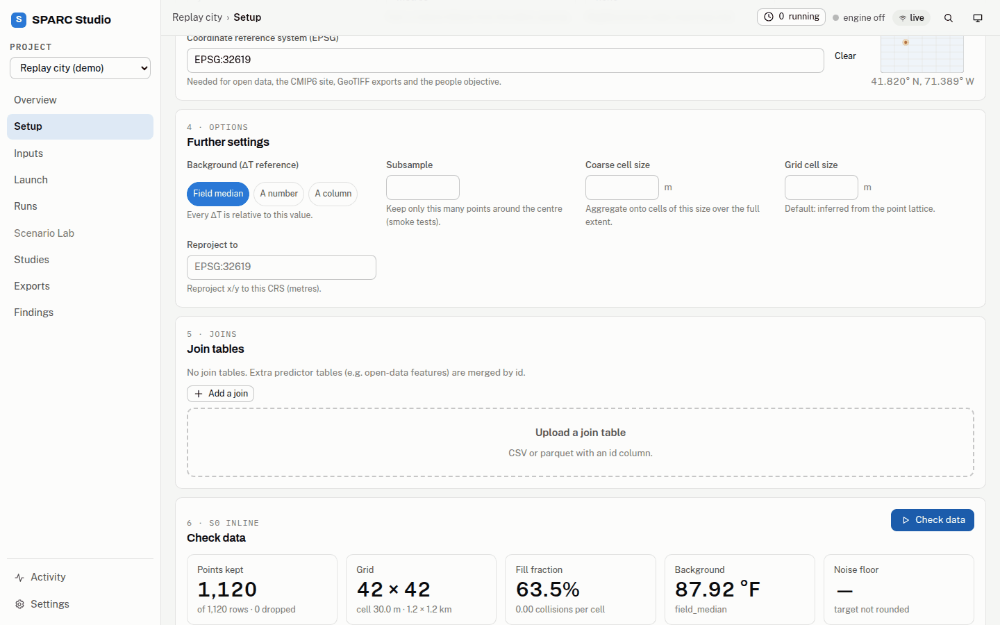

4. **What you can change** (levers): choose the map layers the model uses (predictors), then mark the ones a city can change (tree canopy, paving, roof and surface reflectivity…) with bounds, unit, amounts, direction and cost. The **Size of the change** table (dose scale) flags amounts beyond one standard deviation of what the city has, because the model would be going beyond measured conditions.

   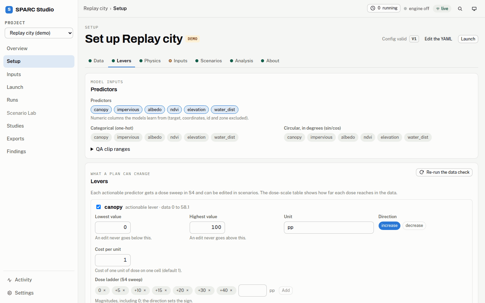

5. **Weather & physics settings**: map the six physics roles (canopy, impervious, albedo, …) to your columns. A missing canopy or impervious role is flagged with what it disables: placebo tests, the simulation check, the planner and the emulator need them.
6. **More data**: four cards, each a tracked download job with its hosts checked first.
   - **Weather on the measurement day** (campaign forcing: ERA5 + the nearest ISD station). If the station list is not cached yet, **Fetch station list** downloads it (about 3 MB) once.
   - **People & land cover** (HRSL + WorldCover) for exposure and equity.
   - **Open predictors** (Sentinel-2 and elevation) — also usable on a city with no predictors at all ("bootstrap" mode): either as a new `<name>_open` project or as this project's predictors.
   - **CMIP6 change factors** for the climate stage.

   Each card ends with **Link into config**, which shows the YAML change before applying it.

   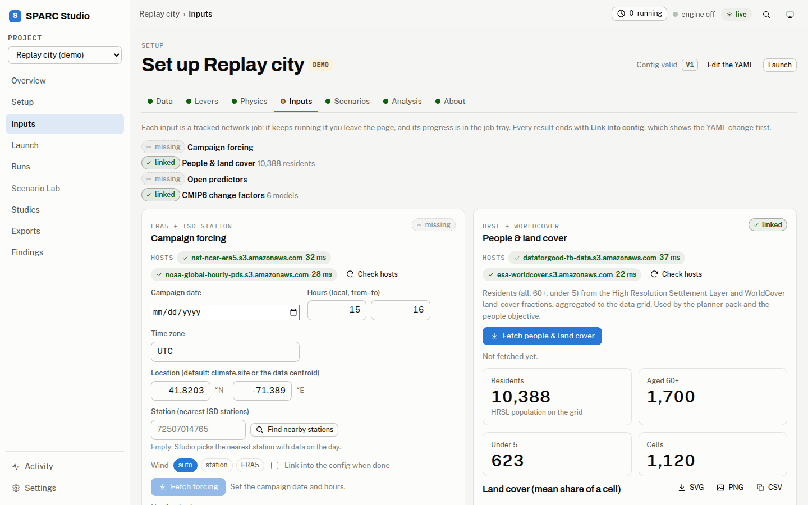

7. **Scenarios**, **Extra checks** and **About** set the scenarios worked out with every run (amount ladders), cause-and-effect checks, future climate, budget plans and report details. The settings are checked as you go (the line at the top right reads "Settings check passed" or counts the problems); **Edit the settings file (YAML)** opens the full config editor with validation, history and the impact preview.
8. **Launch** a **Coarse** run at 60 m first (a faithful preview at a quarter of the places), then a **Full** run overnight.

### J3 — Overnight full run; the laptop sleeps and the server dies

1. Launch **Full** with the distance test (CV curve). Launch shows a time range (e.g. 1 h 40 m – 1 h 55 m), the memory needed (≈3 GB) and disk (≈0.6 GB).
2. Close the lid; the server is killed or the machine sleeps.
3. Next morning run `sparc studio` again. The job's process is gone and the run never ended, so the job is **interrupted**. If its last memory sample was above 80% of RAM, the label says "possibly out of memory".
4. The run page shows the **saved-models card** (checkpoint; Model details › Files, and the Resume dialog): the stages saved (e.g. S3 and the baselines), when, how big, and whether it still **matches the launch snapshot** (data, code and config; "no: code changed" names what differs). Outputs written before the stop (`predictions.parquet`, `baselines.json`) are already viewable.
5. **Resume** shows the plan: S0 reloads the data (always), S1, S2–S3 and the baselines come from the checkpoint, the rest will run, and how much time that saves.
6. The resumed job's rail marks the reused stages **cached**. Both jobs stay linked to the run.

A resume always uses the run's own launch snapshot (`studio/launch.json`), so editing the project config since then never spoils it. **Resume with current project config** is a separate, explicit choice that refits from the first stage your edits touch, and the dialog shows that impact first.

### J4 — Cancel, adjust, relaunch

1. During "Train the models" (S2–S3) the model-blend leaderboard (stacker) and the warnings show something you want to change.
2. **Cancel**. The worker stops at the next safe point (usually within seconds; the model fits check for a cancel between tuning steps) and the job ends **cancelled**. The checkpoint card says what was saved, possibly "none".

   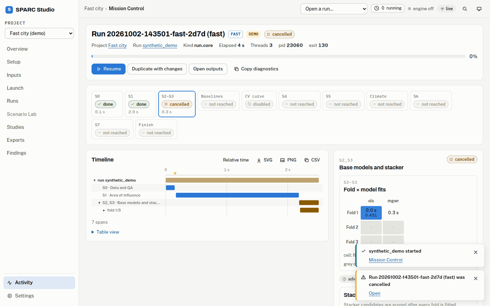

3. Edit the config (Set up, or **Edit the settings file (YAML)**). The **impact preview** lists, per existing run, which config sections changed and from which stage a re-run would refit ("a re-run with this config would refit from S2_S3"). Existing runs are never affected.
4. Relaunch from Launch, or use **Duplicate with changes** in Mission Control, which opens Launch prefilled from that run.

If you resume a cancelled run instead, the saved stages are reused:

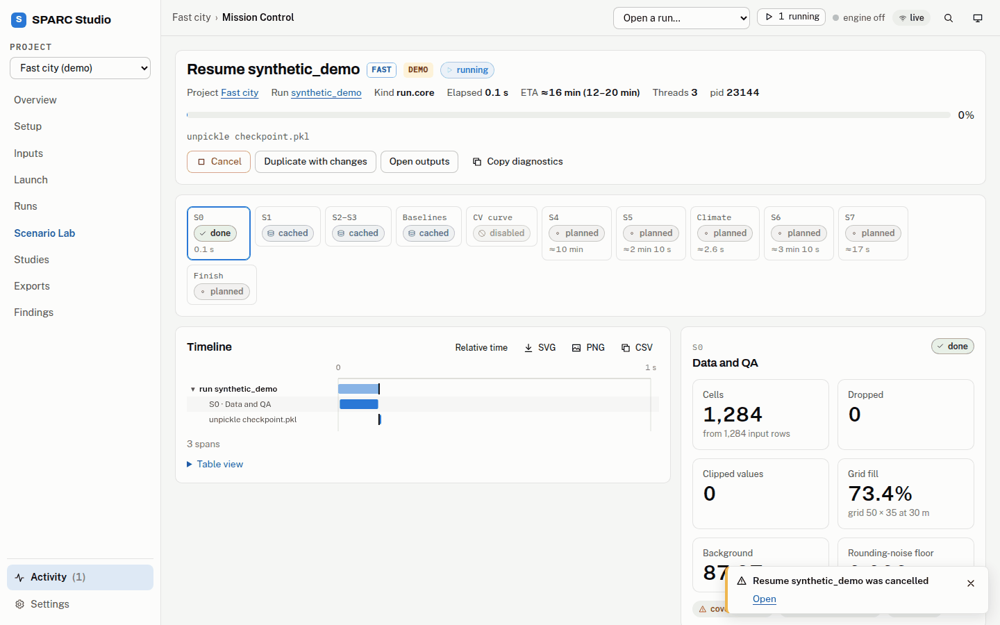

### J5 — Explore every output of a finished run

A run has seven tabs, each the one home of its facts: **Summary · Map · What cools · Heat risk · Scenario Lab · How much to trust this · Model details**. A dot on each tab says ready, partial, running, missing or out of date.

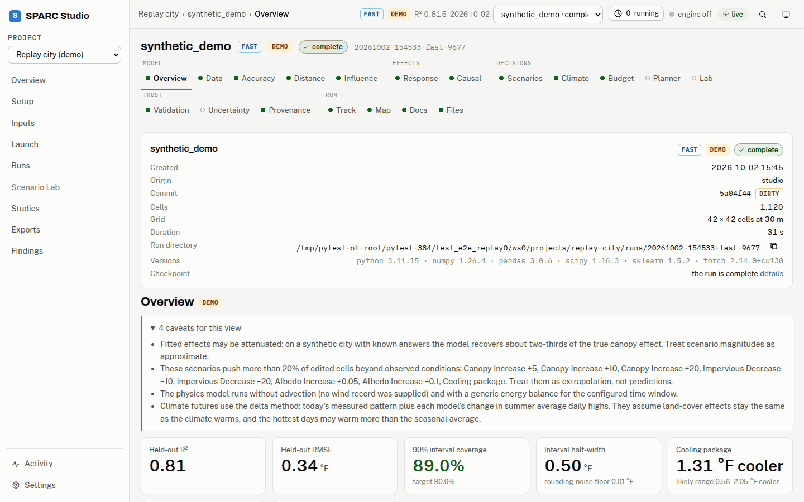

The **Summary** shows four headline cards — cooling potential, residents at heat risk, the trust grade (Good / Fair / Limited) and the climate outlook — each with its likely range and a link to the tab that explains it, the run's notes, and the step rail while the run is going. The technical headline numbers (held-out R², RMSE, 90% interval coverage, interval half-width against the noise floor), step timings, data-health flags, the outputs grid with **stale** badges and the study chips are in **Model details › Run log**. Then tour the tabs ([§6](#6-outputs-and-exports)):

- **Map** shows every layer (temperature, inputs, how the model was tested, effects, cause-and-effect, set-up scenarios, budget, planner and people) on a canvas at one pixel per place, with hexagon views, swipe and side-by-side comparison, and layer export as GeoTIFF, CSV or GeoJSON. Pin a place to see its values and its own cooling-by-amount curves.

  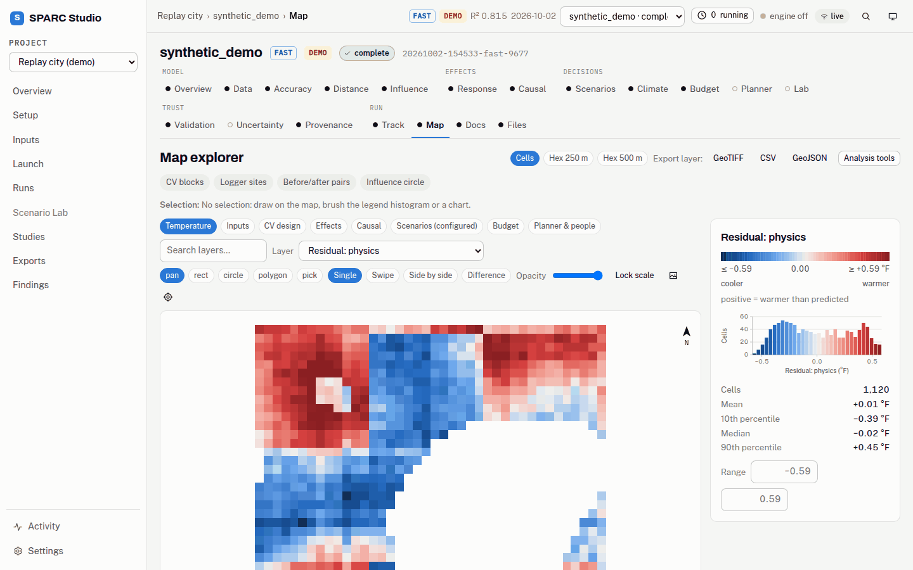

- Brush the far-distance end of the prediction-miss (residual) histogram: the selection appears on the map, and **Analysis tools → Region stats** summarises it with the spread between test areas (jackknife standard error). **Relationships** plots the miss against distance to the places the model was trained on.

  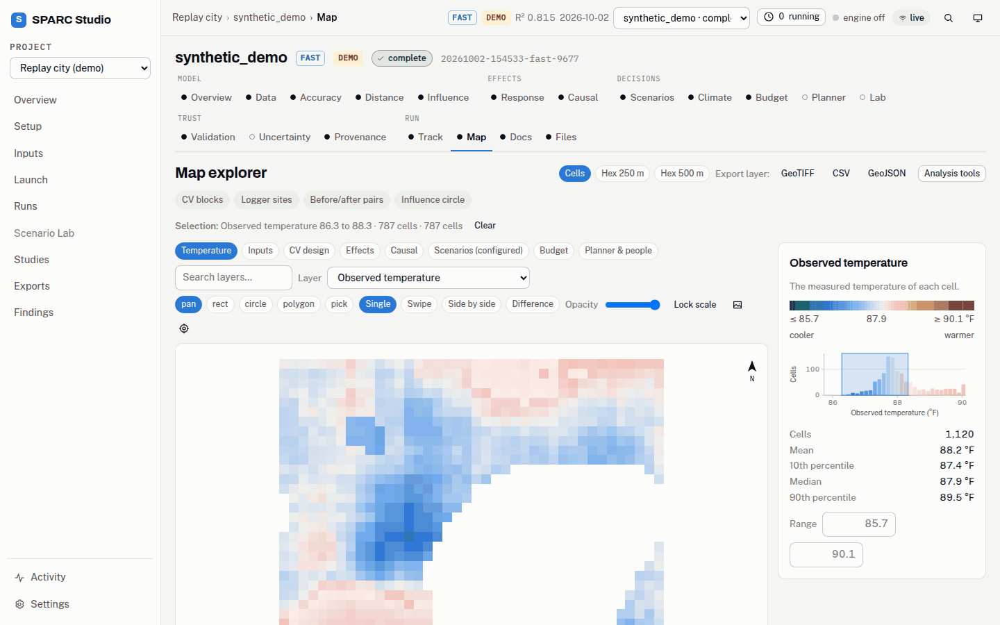

- **Pin to Findings** on any chart keeps the numbers on screen, an image and a note in the project's Findings notebook (**Reports › Notes**, [§6](#findings)).
- Export a GeoTIFF of a layer from the map, and a whole-run ZIP from **Reports** (a tracked job; the saved models are left out unless you tick them).

### J6 — A district scenario (planner)

1. Open the **Scenario Lab** on the full run. The model line under **Run full model** shows the model loading ("Loading model… 60%"), then "Model ready", in about 45 s for a full Providence run.
2. Work through the steps on the left. **01 What to change**: pick **Trees & canopy**. **02 Where**: choose **A neighbourhood** (or **Custom filter…** for e.g. zone 3 **and** `lc_built ≥ 0.5`). The selection reads "1,284 places · 1.16 km² · 6,420 residents · median canopy 12%".
3. **03 How much**: **Use available planting space**, 50%. A sentence under the slider says how much fits. **+ Add another change**: **Cool roofs & surfaces**, **Set to exactly** 0.35 (under Advanced options, which hold the other modes).
4. The **Quick estimate** pane updates as you go, with a trust dot per change ("Quick estimate reliable" / "Quick estimate rough"). Cool roofs are rough citywide in the quick estimate, but this change is local, so the map is not hatched.

   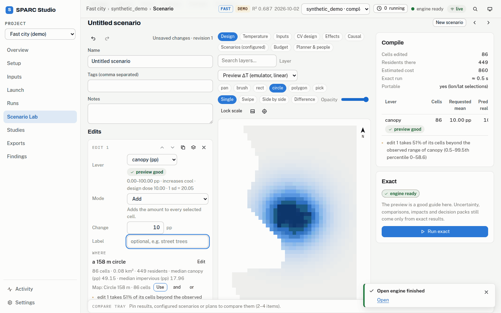

5. **Run full model** (five test-area ticks, ≈13 s on a full run). The answer card gives the cooling where you made changes and citywide, each with a likely range and a confidence chip, then up to four facts (citywide, residents out of Extreme caution, cost, cost per °F). Below it, one section each: **Where it cools** (how far the cooling reaches, by area), **Heat risk & people** (residents at each heat-risk level today, who benefits by fifth of the population), **Against future warming** (mid-century under moderate emissions, with and without the change), **What was actually changed** (what you asked for against what fits), **How sure are we** and **Technical details**.

   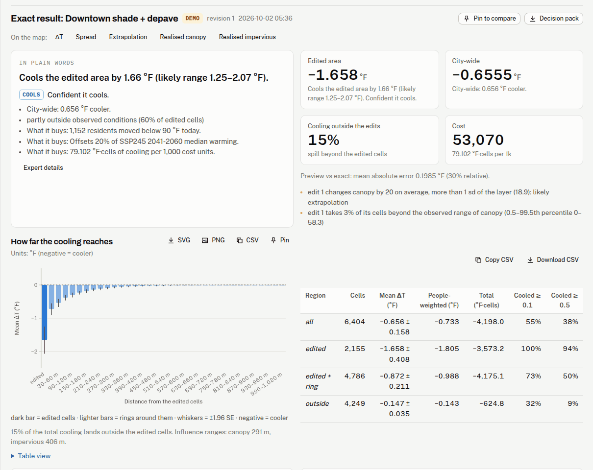

6. **Pin to compare** and compare it with the set-up "Green Infrastructure Package". The uncertainty of the difference (paired standard error) is available at once, because the run stored the per-test-area results of its set-up scenarios.
7. Save, copy it as a variant, and leave the project settings alone: this scenario cannot be written as an amount ladder, and **Add to the project settings…** (promote to config) says it is not eligible and why.

### J7 — Budget plan to field kit

1. Lab → **Plans**: Trees & canopy, a budget of 20,000 pp·places, the planting-space cap on, objective "people", **Who to favour** "share aged 60+" with **How strongly** 0.3.
2. The planned allocation and its **Cooling for each budget** curve update in under a second as you move the slider. With the "people" objective the residents decide where to plant; the **Planned benefit** and the curve stay the plan's total cooling in °F·places (the caption gives the resident-weighted total apart).
3. **Save plan** (with "Check the plan with the full model after saving" ticked), or later **Check with the full model**, re-predicts the whole allocation and reports planned against **Checked benefit**, e.g. "planned 1,704 vs checked 1,037 °F·places": neighbouring changes overlap, so per-place responses do not simply add up (spillover non-additivity).

   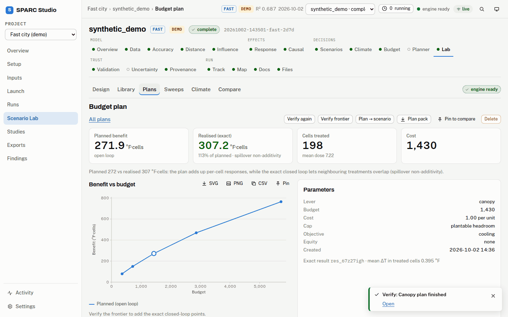

4. **Make a scenario from it** puts the plan in the library as a per-place scenario. **Field kit** lists the places to treat by rank with longitude and latitude, logger sites and matched before/after pairs for evaluation.
5. Export a **Plan pack**.

### J8 — Validation dossier

The run's **How much to trust this** tab opens with the trust grade and four checks (**Accuracy in places it never saw**, **Are the ranges honest?**, **Does it hold up away from measurements?**, **Cause or coincidence?**), then **Independent checks**: one card per study, each with its status, estimated cost, launch form and result chart ([§8](#8-studies)). On the full run:

- **Simpler models** (reference baselines, minutes): does the model blend beat simple spatial models?
- **Fake-change test** (placebo tests: three child runs, each with its own mini step rail): do fake or displaced layers wrongly show an effect?

  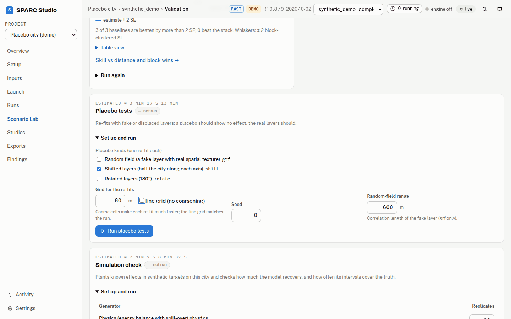

- **Stability across choices** (multiverse: ten variant child runs filling a heatmap): do the conclusions survive reasonable alternative choices?
- **Simulation check** (a generator × seed grid that can be continued across days): how much of a planted effect does the model recover, and do its likely ranges cover the truth?

When an attached study finishes, the **uncertainty report** is rebuilt automatically, and its **All sources together** ranges (uncertainty envelopes) appear on the set-up scenarios and on full-model Lab results. Finish with **Regenerate methods & model card** (Model details › Documents).

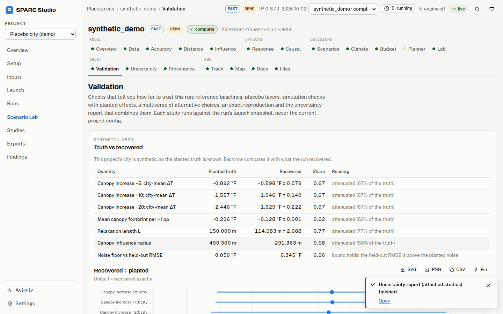

### J9 — Reproduce and compare

1. **Reproduce this run** (Model details › Provenance, or the **Exact re-run** card under Independent checks) re-runs the early stages into a child run and produces a checklist: hard checks (CV design, R² per model, scenario effects, input data) and soft ones (code and package versions).
2. **Compare runs** (select two in Runs, or `/p/<project>/compare?a=…&b=…`) shows the config differences, metrics, scenario effects with likely ranges, whether data, config, code and grid are the same, the package differences, stage timings, and for runs on the same grid a difference map and the agreement of their priority maps.

### J10 — Bring existing work in

1. Home → **Open Providence example** copies the bundled Providence inputs (`brown4.csv`, the campaign forcing, the CMIP6 table and the people/land-cover layers) into a new project.
2. From a repository checkout it can also import the recorded runs and studies under `output/core/providence/` **in place**: `providence_uhi`, `providence_uhi_fast`, and the placebo, simulation-check and multiverse folders.
3. Sections the older code did not write show "not in this run (older code)". Files older than the run's manifest (the fast run's Sep-30 `causal.json` and `allocation.parquet`) are badged **stale**.
4. The full run has no recorded config, so Studio reads it with the example config and tells you so.

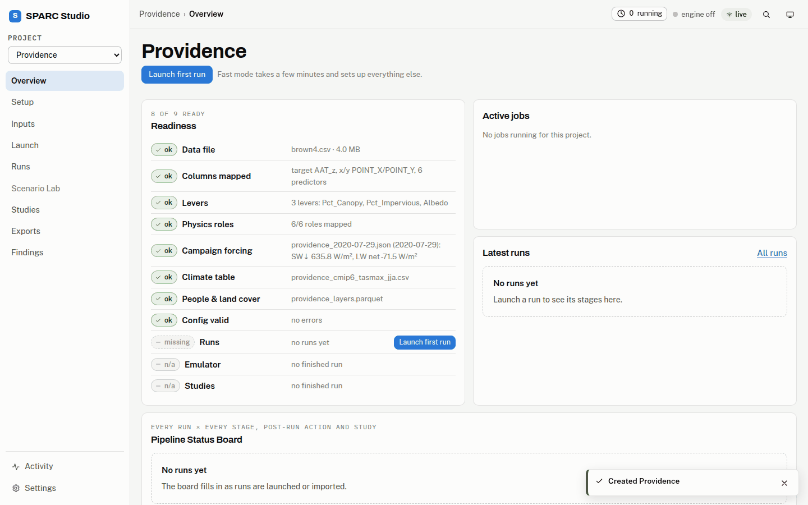

**Import a config / run folder** does the same for your own CLI work: point it at a core YAML config, run folders and study folders. Checkpoint files are Python pickles, which run code when loaded, so imported checkpoints are **untrusted** until you confirm they are your own ("Trust this run's checkpoint?"); until then the Lab refuses to load them, and **Build emulator** is refused too (it loads the checkpoint).

---

## 5. Tracking runs and jobs

Anything slower than about two seconds is a **job**: runs and resumes, post-run actions, studies, input downloads, exports, scenario-engine requests. Each job is a separate process with its own folder (`jobs/<job id>/`), an append-only event log, live updates, a real Cancel and, where the pipeline supports it, Resume. Closing the browser never affects a job.

### Job and stage states

| Job status | Meaning |
|---|---|
| queued / blocked | Waiting for a slot, for a lock on its run, or for the job it follows; *blocked* says why and offers actions |
| starting · running | The worker process is up |
| cancelling | Cancel was requested; the worker stops at the next safe point |
| succeeded · failed · cancelled | Finished |
| interrupted | The process vanished without finishing (server killed, machine slept, out of memory). Runs can be resumed |

Each stage chip on the rail shows its state in words and an icon (never colour alone): **planned → running → done | failed | cancelled | not reached**, or, without running, **skipped** (with the reason), **cached** (from the checkpoint), **disabled** (by the config) or **not requested**. Hover a chip for the reason; click it to open its live panel.

Runs have their own status in the run lists: queued, running, complete, **partial** (stopped with saved stages: always resumable), failed, cancelled, interrupted, live CLI run, or imported.

### Progress and ETA

Progress is **cost-weighted**: each planned unit of work (a model fit in a fold, an engine pass, a causal step…) counts by how long it usually takes, so 50% means half the expected time, not half the stages. The ETA is a **range**: Studio starts from seeded rates, learns from the runs on this machine (per-host medians) and refines the estimate while the run goes. Launch, Resume and the study forms show estimates before you start.

Known limitation: the ETA shown at the start of a **resumed** run does not yet discount the stages that will come from the checkpoint, so it can read much longer than the resume takes; it corrects itself as stages finish.

### Mission Control

Open a job from the job tray, Activity, or a run's **Model details › Run log** (the run's latest job, with a switcher for its earlier ones).

- **Header**: mode badge, status, elapsed time, ETA range, progress bar, the current position (e.g. `cv_curve › 1000 m blocks › fold 4/5 › mgwr › tuning 9/13`), threads and process id. Buttons: **Cancel**, **Force stop** (after the grace period), **Resume**, **Retry**, **Duplicate with changes**, **Open outputs**, **Copy diagnostics** (a JSON blob with the job, its last 200 events and the versions, for bug reports).
- **Step rail**: eleven chips in plain words (Check the data, Measure reach, Train the models, Simple-model check, Distance test, Cooling by amount, Scenarios, Future climate, Cause checks, Budget plan, Write the report); each chip's tooltip gives its stage code (S0 … finish), with durations or estimates and markers where the models were saved.
- **Timeline**: the span tree (run › stage › task) with bars growing live, warning ticks and checkpoint flags. Gaps of more than 45 s between heartbeats show as a hatched "system sleep?" band. Export it as SVG, PNG or CSV.
- **Live stage panel**: the QA tiles of S0, the influence ranges of S1, the fold × model heatmap and stacker leaderboard of S2–S3, the baseline forest, the skill-versus-distance curve, the dose–response small multiples of S4, the scenario feed of S5, the causal checklist of S6, planned versus realised of S7.
- **Bottom tabs**: Logs (filter by level, logger, stage and text; hover a line for its full message; download the raw logs), Warnings (grouped with counts, linked to the relevant view), Outputs (each file as it is written, clickable mid-run), Checkpoints, Resources (memory, CPU and processes, with a warning above 80% of memory) and Config & provenance.

Study jobs add a **child matrix** above the tracker: the placebo kinds with their mini rails and verdicts, the multiverse variants, the simulation-check generator × seed grid, the reproduction checklist.

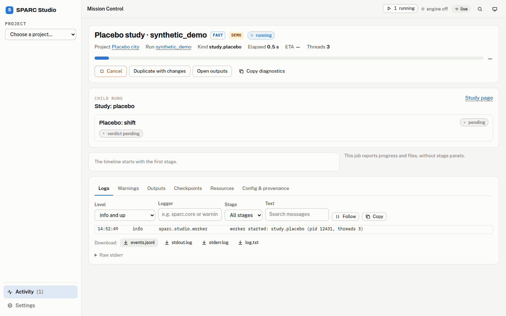

### Cancel, force stop, resume

- **Cancel** asks the worker to stop. It stops at the next safe point (between folds, models, stacker candidates, CV partitions, doses, scenarios, treatments, climate models, replicates and variants, and inside the long model fits), saves nothing half-written and exits; the job ends **cancelled**.
- **Force stop** becomes available 90 s after a cancel. It kills the job's whole process group, pool workers included. Checkpoints and output files are always written atomically, so a force-stopped run is consistent with its last checkpoint.
- **Resume** creates a new job on the same run folder. It reuses the stages saved in the checkpoint as long as the checkpoint matches the launch snapshot; only the number of threads may change. Studies resume at their own granularity: a simulation check skips finished (generator, seed) pairs, a multiverse skips finished variants, a placebo suite resumes per kind.
- **Retry** starts a new job with the same parameters (for a run, that is a resume when a checkpoint exists).

### Interrupted runs and restarts

When the server starts it looks at every job that was running. A job whose process is still alive (same process id *and* start time) is **reattached**: Studio follows it to the end as if nothing happened. Otherwise the job becomes **interrupted** and the run's state is recomputed from its `run_state.json` and `checkpoint.json` (Studio never unpickles a checkpoint just to show this).

Out-of-memory labels:
- a worker killed by the system while its memory was above 80% of what was available ends **failed** with "likely out of memory (peak 11.8 GB of 15.0 GB)";
- an interrupted job whose last memory sample was high says "process vanished; possibly out of memory".

### Activity, Status Board and run history

- **Activity** lists the queue (reorder by priority, pause the queue), running jobs, history with filters, and interrupted jobs with Resume.

  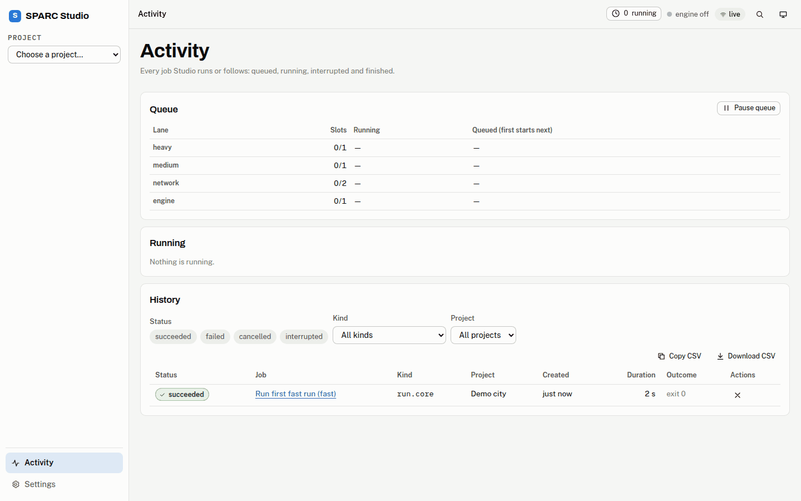

- The **Pipeline Status Board** on the project overview has one row per run and one column per stage, post-run action and study: done (seconds), cached, running (%), failed, skipped (reason), disabled, stale or not run, each with its action. It covers runs made with the CLI too. A post-run job still waiting in a launch's "then run" chain shows as running with "queued".
- **Runs** lists the project's runs (and `/runs` the whole workspace's) with mode, duration, accuracy score (R²), typical error (RMSE), range reliability (coverage), saved-models size, studies and code version (commit); a stage-duration chart across runs, grouped by commit, shows performance changes. Select two to compare.
- **Notifications**: a toast with the headline numbers when a job ends, an optional browser notification (Settings), and the count in the tab title.

### Runs started from the command line

Add the folder that holds your CLI runs to **Settings → Watch roots**. Studio scans it every 10 seconds. A run whose `run_state.json` is fresh shows as a **live CLI run**, with full Mission Control when the run writes progress events:

```bash
sparc core run --project configs/core_providence.yml --fast --progress progress.jsonl
```

(or set `SPARC_PROGRESS=<file>`). Without progress events Studio shows the stage-level state from `run_state.json`. Studio cannot cancel a CLI run; it shows the process id instead.

---

## 6. Outputs and exports

### Run tabs

A run has seven tabs. The first six speak to planners in plain words; every technical view lives, complete, under **Model details**. Each fact has one home, and the other tabs link to it in one line.

| Tab | What it shows |
|---|---|
| **Summary** | Four headline cards — **Cooling potential**, **Residents at heat risk**, **How much to trust this** (the trust grade) and **Climate outlook** — each a number with its likely range and a link to its home; the run's notes; the step rail while the run is going |
| **Map** | The map explorer and analysis tools: every layer, a pinned place's values and its own cooling-by-amount curves |
| **What cools** | **What each change does**: per lever, the cooling by amount (dose–response curve) with its likely range, how quickly extra effort stops paying off (**Diminishing returns**: "In 72% of places each extra step of canopy cools less than the last; about 90% of the possible cooling comes by +18 pts"), the shape of the response in each place (Diminishing · Steady · Slow start, then strong · Hit the limit), and a marker at the amount that gives 90% of the cooling; then **how far cooling reaches** and **where to act** (available planting space, zones, sites) |
| **Heat risk** | Three sections: **Today** (feels-like temperature, residents at each heat-risk level, [Heat stress](#heat-stress-and-verdicts)) · **Who is exposed** (average temperature where people live, hot days per year, who gets the cooling by fifth of the population) · **Future climate** (warming by emissions future and time period, heat risk in each future, how much warming the changes cancel, "can adaptation keep up") |
| **Scenario Lab** | Design · Library (with the run's set-up scenarios) · Plans (with the run's budget plan) · Compare · More tools (Try amounts) ([§7](#7-scenario-lab)) |
| **How much to trust this** | The trust grade (**Good / Fair / Limited**, from the accuracy score in places the model never saw, with a check that its likely ranges hold), then four checks — **Accuracy in places it never saw** · **Are the ranges honest?** · **Does it hold up away from measurements?** · **Cause or coincidence?** — then **Independent checks** (study cards, [§8](#8-studies)), **How wide the ranges are** and **Limitations** |
| **Model details** | A left rail of technical sections, each with a one-line plain intro and an ⓘ on its technical name: **Data & checks** · **Accuracy** (each model and the blend, observed vs predicted, misses by zone and test area, interval honesty, blend weights, physics, wind, weather inputs, how the model was tested) · **Reach & spatial structure** (skill against test-block size, simpler models, influence distances, correlograms, rings, direction, starting assumptions) · **Response curves** (partial dependence, fold means, published studies) · **Cause-and-effect audit** (forest, audit, doubly-robust curve, effect by place, sensitivity) · **Uncertainty sources** · **Run log** (the run's record — headline technical numbers, step timings, data health, the outputs grid, study chips — and Mission Control for its jobs) · **Provenance** (hashes, git, platform, packages, effective config, launch snapshot, Reproduce) · **Documents** (run report, methods, model card and study write-ups; Regenerate) · **Files** (every file with its catalogue entry, the data dictionary, previews, raw downloads and conversions, and the saved-models card) |

Every tab opens even mid-run. A missing output names the step or study that produces it and offers the action ("Resume to compute S6", "Run planner pack"). A step a finished run skipped offers **Re-run with <step>**, which opens Launch prefilled from that run. Sections that older code did not write say "not in this run (older code)". Old links (`/r/<run>/accuracy`, `/r/<run>/climate`, `/r/<run>/track`, …) redirect to the new home of their content.

### Heat stress and verdicts

Air temperature alone understates danger: humidity slows sweating, so the same air temperature feels hotter on a muggier day. **Heat risk › Today** turns each place's measured temperature into a **feels-like temperature** (the US National Weather Service **heat index**) using the measured afternoon's dewpoint (from the forcing file: the airport station's, else ERA5's) and counts residents at each **heat-risk level** (the NWS categories):

| Heat-risk level | Feels-like temperature (heat index) | What can happen |
|---|---|---|
| Caution | 80–90 °F | fatigue with prolonged exposure or activity |
| Extreme caution | 90–103 °F | heat cramps and heat exhaustion possible |
| Danger | 103–125 °F | heat cramps or exhaustion likely, heat stroke possible |
| Extreme danger | ≥ 125 °F | heat stroke highly likely |

The page opens with a five-part brief written from the numbers: **how hot it felt**, **who is exposed**, **as the climate warms**, **what helps** and **how sure**. Below it: key numbers, residents by category today, with the adaptation package (the config's first joint scenario) and under each climate pathway (switch the period and the humidity assumption), the distribution of the heat index across the city, the heat-risk map, a futures table and the verdict table.

- **Futures** (Heat risk › Future climate) add each emissions future's median warming to the measured afternoon; each is named in plain words, e.g. "Moderate emissions, mid-century (2041–2060)", with the SSP code in its tooltip. Future humidity is uncertain, so every future is a range between **constant dewpoint** (moisture unchanged, the lower end) and **constant relative humidity** (moisture rises with warming, the upper end), widened by the climate models' 10th–90th percentile warming. The heat index is steep near the category edges, so a few tenths of a degree can move many residents across one; read the ranges, not one number.
- **What-if humidity**: pick a preset (dry 10 °C to oppressive 24 °C) or type a dewpoint to recompute everything for a muggier or drier afternoon. A run without campaign humidity asks for one instead of guessing.
- **Verdicts** turn each scenario's uncertainty into plain words: **Solid** (robust: the plausible range excludes no change and every analysis variant agrees on the sign), **Direction clear** (direction only: the sign holds but the size could be close to zero) or **Not proven** (not established: it cannot be told apart from what the pipeline reports when the simulation plants no effect, or most changed places are beyond measured conditions). An asterisk marks a qualifier such as going beyond measured conditions; hover, tap or focus it for the reasons. Verdicts need the **All sources together** ranges (uncertainty envelopes; Model details › Uncertainty sources).
- In the **Map** explorer, the "Heat stress" group holds the feels-like temperature and the heat-risk level, today and with the package.
- In the **Scenario Lab**, the quick-estimate pane shows the draft's heat-risk shift live while you edit: how many residents it would move out of Extreme caution or worse. When the run's set-up scenarios for a lever are Not proven or Direction clear, the pane says so, so a quick estimate never reads as more certain than the evidence. A full-model answer card leads its facts with the residents it moves out of Extreme caution, and **Heat risk & people** gives every level today and in each future. The decision pack and the report export ("Heat stress" section) carry the same numbers.

### Findings

**Pin to Findings** (on charts, maps and result cards) stores the view and its full URL state, a title, a Markdown note, the numbers on screen and an optional image. The **Findings** notebook (**Reports › Notes** per project, or `/findings` for all projects) lets you reorder (drag or move buttons), annotate in place, filter by run, open each finding exactly where it was pinned, and export the notebook as a Markdown ZIP with images or a self-contained HTML file. Exports reproduce the snapshotted numbers and carry a provenance block and the caveats.

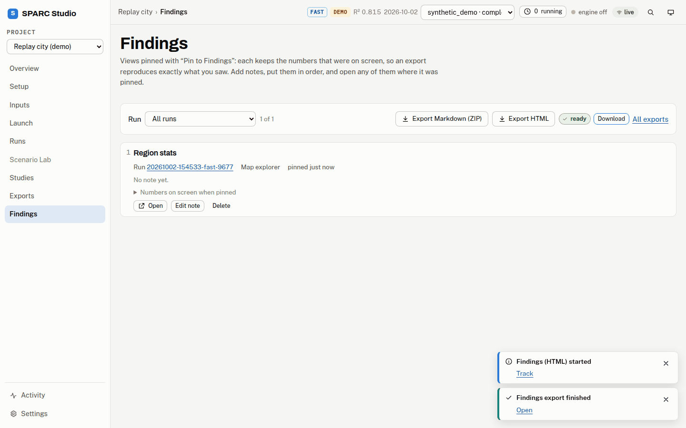

### Exports & reports

**Reports › Reports & exports** has the report builder, one card per export and the project's export history. Every export is a tracked job that writes into `projects/<slug>/exports/<export id>/`; the history lists them with their status, size, **Download** and **Delete**.

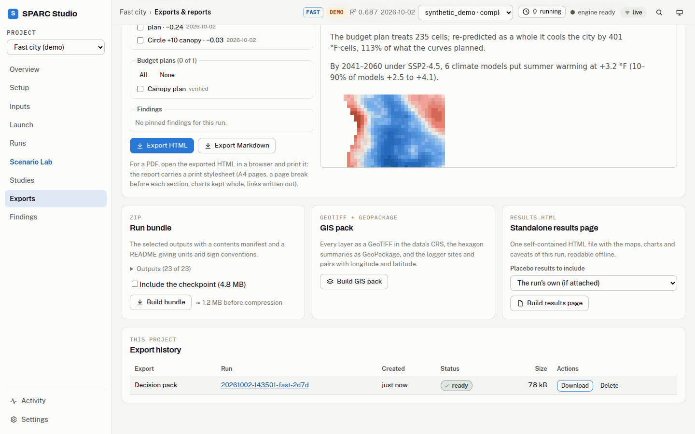

| Export | What you get |
|---|---|
| Any layer (Map, Lab) | GeoTIFF (float32, the data's CRS, NaN for no data), CSV or GeoJSON, straight away |
| Charts and maps | SVG, PNG or CSV from each chart's toolbar |
| Run bundle | A ZIP of the outputs you tick, a contents manifest and a README with units and sign conventions. The saved models (checkpoint) are excluded unless ticked; links that point outside the run are never followed |
| GIS pack | One ZIP: every layer as GeoTIFF, `hexagons.gpkg` (250 m and 500 m hexagons), logger sites and before/after pairs with longitude and latitude, and a README |
| Standalone results page | One self-contained `results.html` with the run's maps, charts and caveats, readable offline. Optionally includes a placebo study |
| Project report | The report builder: pick sections (summary, accuracy, validation, scenarios, plans, climate, equity, caveats, limitations, provenance, findings) and the results, plans and findings to include, preview it, then export **HTML** (with a print stylesheet: print to PDF from the browser) or **Markdown** (maps embedded) |
| Findings | Markdown ZIP with images, or self-contained HTML |
| Decision pack (Lab result, **Export decision pack**) | `brief.html`, `scenario.json`, `summary.json`, `cells.csv` (id, lon, lat, zone, ΔT, its sd, extrapolation, realised change), `delta.tif` and realised-change GeoTIFFs, hexagon tables, `README.txt` |
| Plan pack | The decision-pack contents plus the field list, logger sites, before/after pairs and the Pareto table |
| Compare pack | Per-item summaries, paired differences, difference GeoTIFFs and a brief |

Packs are built from **full-model** results. A pack made from a scenario without a full-model result, or from an unchecked plan, is stamped **DRAFT**, carries no standard errors and is built from the quick estimate (so it needs the run's quick estimate); its share beyond measured conditions reads "not computed (preview)". A plan's planned benefit is never used as a temperature-change map: each treated place holds the cooling its amount brings to its whole neighbourhood (°F·places).

Runs without a CRS cannot produce longitude/latitude, GeoTIFF, GeoPackage or GeoJSON; the buttons say so.

---

## 7. Scenario Lab

The Lab is where planners spend their time. It opens on a run with saved models (a checkpoint; the active run, else the latest one) and has four pages, **Design**, **Library**, **Plans** and **Compare**, plus **More tools** (**Try amounts**). Climate × adaptation now lives in **Heat risk › Future climate** (the old Lab › Climate link redirects there).

**Design** is a step flow, with the map in the middle and the quick estimate on the right:

1. **01 What to change**: lever cards in plain words — **Trees & canopy**, **Less paving**, **Cool roofs & surfaces** — each with a one-line effect and a trust dot (how reliable the quick estimate is for it).
2. **02 Where**: **Whole city** · **A neighbourhood** · **Hottest places** · **Where most people are exposed** · **Draw on the map**, or **Custom filter…** for the full selection builder.
3. **03 How much**: **Add** · **Bring up to at least** · **Use available planting space**, a slider in the lever's own units and a live sentence ("You asked for +20 pts; about 14 pts fits — the rest exceeds available space"). **+ Add another change** stacks more; finished changes collapse into sentences.
4. **Quick estimate** pane: the cooling where you made changes and citywide, area and residents, estimated cost, the heat-risk shift and a plain trust line ("The quick estimate is reliable for this change" / "Rough in the hatched areas — run the full model for a firm answer").
5. **Run full model (≈ N min)**: the one primary button, with the model's state on one line under it.
6. **Advanced options** (one disclosure): the other modes (Set to exactly, Multiply by, Cap at, to a percentile, per place), **Keep changes within realistic limits**, **Include knock-on effects**, **Reusable in other runs**, the per-change details table, warnings and **Expert mode**.

**Start from an example** offers templates; the full scenario editor (all modes, costs and files) stays one link away under Advanced options.

### The full model

Full-model results need the run's fitted models in memory. Studio keeps them in a long-lived **scenario engine** process that holds a few loaded runs (two by default, within a memory budget) and serves one request at a time. The model line under **Run full model** (and the full-model dot in the top bar) shows its state: "Model loads when you run it", "Loading model… 42%", "Model ready", "Model busy — your run will wait its turn", or "Model not available for this run — quick estimate only" (no saved models, or they were written by a different version of the pipeline; see [§10](#incompatible-checkpoints-and-stale-results)). Before loading a run Studio checks the memory it needs and, if it does not fit, offers to evict another run or to wait for a job to finish. Loading takes about 2 s for a fast run and 40–60 s for a full run (faster the second time).

### Scenarios, edits and selections

A **scenario** is a named, revisioned list of **changes** (edits). Each change is a lever, a mode, an amount and **where** it applies:

| Mode | Meaning |
|---|---|
| Add · Set to exactly · Multiply by | Add an amount, set a value, multiply (add · set · scale) |
| Bring up to at least · Cap at | Raise places to at least, or lower them to at most, a value (floor · ceiling) |
| Use available planting space | Plant on a share of the open ground that can take trees (fill headroom; needs the people & land-cover layers) |
| To a percentile | Bring places up to a percentile of the city |
| Per place | A value per place: a brush stroke, an uploaded CSV of `id,lever,change` (or `id,lever,value`) or a budget plan |

**Selections** combine zones, drawn shapes (rectangle, circle, polygon, in longitude/latitude so they travel between runs), filters on any column ("canopy ≤ 40", "top 10% hottest"), hexagons, buffers around another selection, uploaded cells and saved regions, with and / or / minus / not. The selection always says how many places, how much area and how many residents.

Changes outside a lever's bounds are held back the way the engine clips them (a place already outside the bounds is never pushed further out); **What was actually changed** reports what fitted. Map layers a city cannot change can be edited only in **Expert mode**.

**Templates** start you off: *Cool roofs on built-up cells*, *Shade the hottest X%*, *Fill X% of plantable space*, *Depave the most paved blocks*, *Prioritise by footprint*, *Around sites* (uploaded or typed points) and *Configured package*.

### Quick estimate versus full model

| | Quick estimate | Full model |
|---|---|---|
| What | A linear emulator built from the run (emulator preview) | The run's own fitted models (exact engine) |
| Speed | ≈0.02–0.15 s, live while you edit | ≈2 s (fast run) to ≈13 s (full run) after the model has loaded |
| Uncertainty | none | likely range from the test areas (cross-validation folds) |
| Diminishing returns, realistic limits | no | yes |
| Used for | design and exploration | every number you report, compare or export |

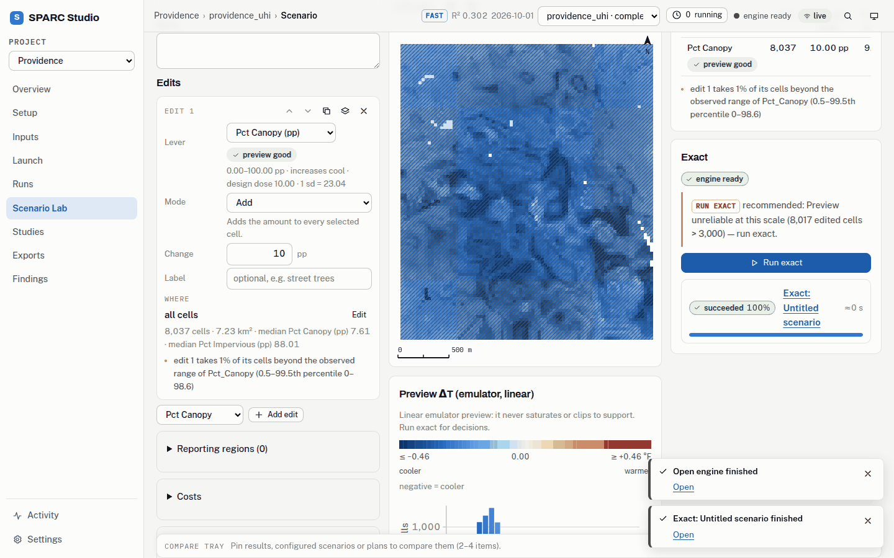

The quick estimate has to be built once per run. If it is missing, the Lab offers **Build quick estimate** (about a minute for a fast run, 4–5 minutes per lever on a full run; the button gives the time); full-model results work without it. Each lever carries a **trust dot** from the quick estimate's own validation: *Quick estimate reliable*, *Quick estimate rough* or *No quick estimate*. The map is **hatched** ("Rough estimate here") when more than 3,000 places are changed, a rough lever changes more than 1,000 places, or a citywide change uses a lever the quick estimate gets badly wrong.

### Reading a full-model result

The **answer card** speaks plain language:

- A headline without numbers ("**Cools the places you changed**", "May cool the whole city" when the range crosses zero) and one big number with its likely-range strip on a zero line, e.g. −0.62 °F where you made changes (likely range −0.80 to −0.44 °F).
- A confidence chip: **Confident it cools** when the whole 95% likely range is on the cool side, **Confident it warms** on the warm side, **Might be no real effect** otherwise.
- Up to four facts: **Citywide**, **Residents out of Extreme caution** (when the run has campaign humidity; [Heat stress](#heat-stress-and-verdicts)), **Estimated cost** and **Cost per °F**.
- **Keep in mind** qualifiers when they apply: "partly beyond the conditions measured in this city (23% of the places you changed)", "A separate cross-check finds less cooling — see How sure are we", "preview only — not verified".
- Actions: **Pin to compare**, **Export decision pack**, **Show on map**.

Below the card, each item once, in sections that open on demand: **Where it cools** (how far the cooling reaches, by area, the map layers) · **Heat risk & people** (residents by heat-risk level, who benefits, hot days) · **Against future warming** (how much of the coming warming it cancels) · **What was actually changed** (what you asked for against what fits, and what knock-on effects like NDVI did) · **How sure are we** (quick estimate vs full model, the sources of doubt, cross-checks) · **Technical details** (for analysts: standard errors, the spread between test areas, place counts, every area and saved region, method notes).

Results are cached by content: running the same scenario on the same run and saved models returns the stored result at once. When the run's saved models or the pipeline code change, old results are marked **out of date** but stay readable.

### Library, revisions and promotion

Scenarios autosave every two seconds; undo and redo cover the last 50 steps. Their status moves draft → quick estimate → full model, and becomes out of date when the run or code changes. Changing a scenario that already has a full-model result **forks** a new revision instead, so results are never orphaned; the library shows the lineage tree, tags and the run's **set up with this run** scenarios (configured scenarios, read-only: **Clone to edit**). From a scenario's **More…** menu: **Copy as a variant**, **Try growing amounts (ladder)…** (a series of amounts run in one batch), **Check across runs…** and **Add to the project settings…** (promote to config: writes a whole-city scenario into the project config as a ladder or package, with a YAML diff first; the current run is never touched).

### Compare and check across runs

**Compare** takes two to four items pinned with **Pin to compare** (full-model results, set-up scenarios, plans, the baseline): locked-scale maps, the A − B difference map with swipe, a table with the **uncertainty of the difference** (paired standard errors), areas, equity, exposure, cost and cause-and-effect bands. Differences always read A − B: a negative value means A cools more. The confidence line says it in words, for example "Shade cools the city 0.97 °F less than Cooling package (likely range 0.77–1.16 °F). Confident there is a difference." Paired errors use the shared test-area models, so they are much tighter than comparing two independent ranges; set-up scenarios of older runs offer to re-run them with the full model for the paired error. An unchecked plan has no per-place temperature change: it is compared by its citywide mean, cost and cooling per cost only, without where-changed, area, equity, exposure or difference maps, until you check it with the full model.

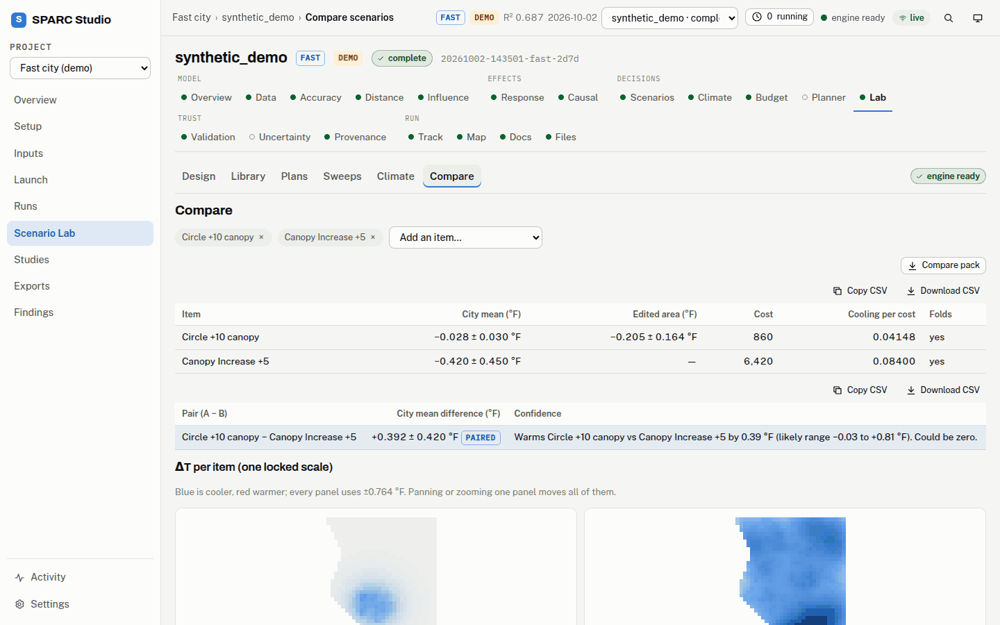

**Check across runs** evaluates the same scenario on other runs of the project (fast, coarse, full, open-data, multiverse children), as one heavy job that shows its time and the memory needed before it starts. The spread becomes the **Across model versions and runs** band (specification uncertainty) of the full-model results of the version it checked, including ones computed before the check; a draft edited afterwards needs a new check.

### Try amounts and plans

- **Try amounts** (More tools; a dose sweep) runs one lever at a series of amounts in an area and fits the diminishing-returns curve to the area's benefit against the amount asked for (the chart's axis: the overlay, its **Amount for 90% of the cooling** line (d90) and caption), overlaid on the run's response curves. The fit against the **amount nearby** (neighbourhood dose: the smoothed amount around each place, smaller for an area sweep) is quoted in its own units, with each point's amount nearby in the table.
- **Plans** ([J7](#j7--budget-plan-to-field-kit)) optimise a single-lever budget: budget slider, cost (a number or any cost column), caps (available planting space, an area), a **smallest amount per treated place** (allocations below it are dropped and the freed budget is reported, not re-spent), objective (cooling or people reached) and **Who to favour** (score source and **How strongly**). **Check with the full model** and **Check every budget** run the allocation, or the whole curve, through the full model. Combining several single-lever plans in one scenario is allowed and labelled "not jointly optimal".

### Climate × adaptation

**Heat risk › Future climate** combines the run's CMIP6 change factors (SSPs, periods, a statistic across models) with today's measured pattern and any adaptation (full-model results or set-up scenarios): warming by period, exposure above your thresholds, how much of the warming each adaptation offsets, and future-temperature maps that update instantly. Without a climate table it offers **Fetch CMIP6 change factors**.

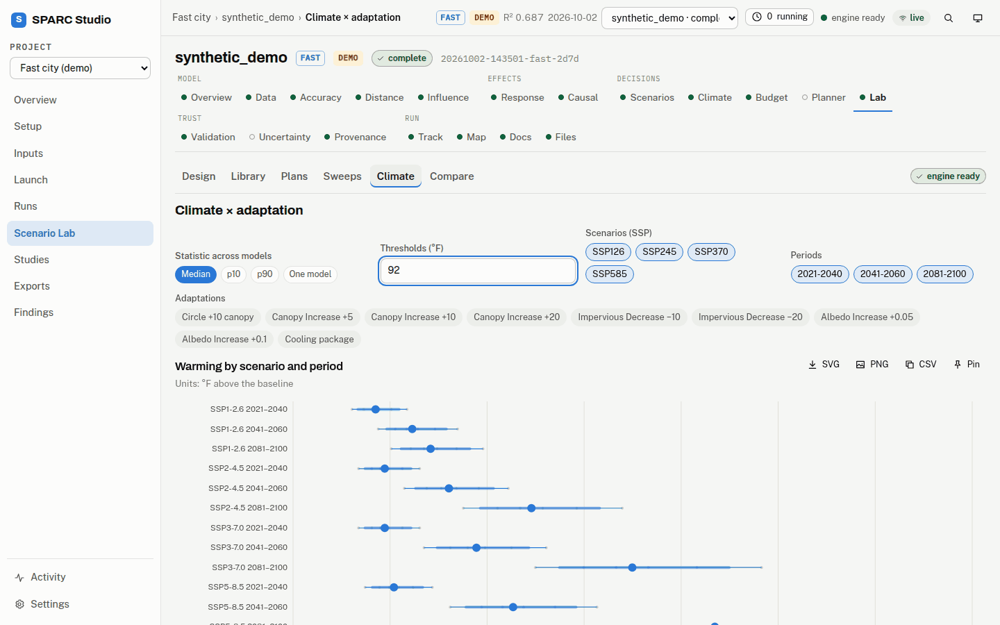

---

## 8. Studies

Studies are the evidence that a run can be trusted. All of them are tracked jobs that use the **run's launch snapshot**, never the current project config, and write either into the run (post-run actions) or into `projects/<slug>/studies/<study id>/` (studies, with their child runs under `children/`).

| Card | Kind | What it does | Needs | Typical cost |
|---|---|---|---|---|
| Simpler models (reference baselines) | action | Scores simple spatial baselines against the model blend | predictions | minutes |
| Planner pack | action | Exposure, hot days, equity, plantable space, hexagons, logger sites and pairs, GIS files | `planner.layers` | minutes |
| Quick estimate (scenario emulator) | action | Builds the linear emulator behind the Lab's quick estimates | the saved models | ≈1 min fast, 4–5 min per lever full |
| All sources together (uncertainty report) | action | Layered ranges per scenario from the attached studies | — | seconds |
| Methods & model card | action | Regenerates `methods.md` and `model_card.md` from the merged manifest | — | seconds |
| Fake-change test (placebo tests) | study | Re-fits with a random field, shifted or rotated layers (one child run each); a placebo should show no effect | canopy/impervious roles | minutes per kind at 60 m |
| Simulation check | study | Plants known effects on this city with several generators × seeds and measures recovery and interval coverage | both roles | long; resumable |
| Stability across choices (multiverse) | study | Re-runs alternative modelling choices (built-in and custom variants) and checks that effects and priorities agree | — | one child run per variant |
| Exact re-run (reproduction) | study | Re-runs S0–S3 into a child run and checks the results match | a recorded config | like the original stages |
| Known-effect test (effect benchmark) | project study | Recovery of known effects on synthetic cities with and without Spatial+ | nothing | minutes |
| Published studies (literature check) | panel | How the run's response rates compare with published ones (from the response stage) | — | — |

Each card (under **How much to trust this › Independent checks**) shows its status (not run, queued, running, done, **out of date**, failed), the estimate, what is missing if it cannot run, its result chart, and **Run again** prefilled from the last parameters. For simulation checks and multiverses, workers × threads must fit the heavy-job thread setting.

- **Attach / Detach** (placebo, simulation check, multiverse): attached studies feed the run's uncertainty report. Studies launched from a run are attached to it automatically. When an attached study finishes, or you attach or detach a finished one, the uncertainty report is rebuilt (Settings → "Rebuild uncertainty envelopes when an attached study finishes").
- **Stale**: a study is stale against a run whose checkpoint has changed since the study ran.
- The **Studies hub** (sidebar › Advanced) shows a status matrix for every run of the project, the project's studies by kind, and the effect benchmark launcher. Each study has its own page with its result view, its child runs (each linking to its run and tracker), attach/detach, resume (for studies that stopped unfinished), delete, and for simulation checks a **merge** across studies.

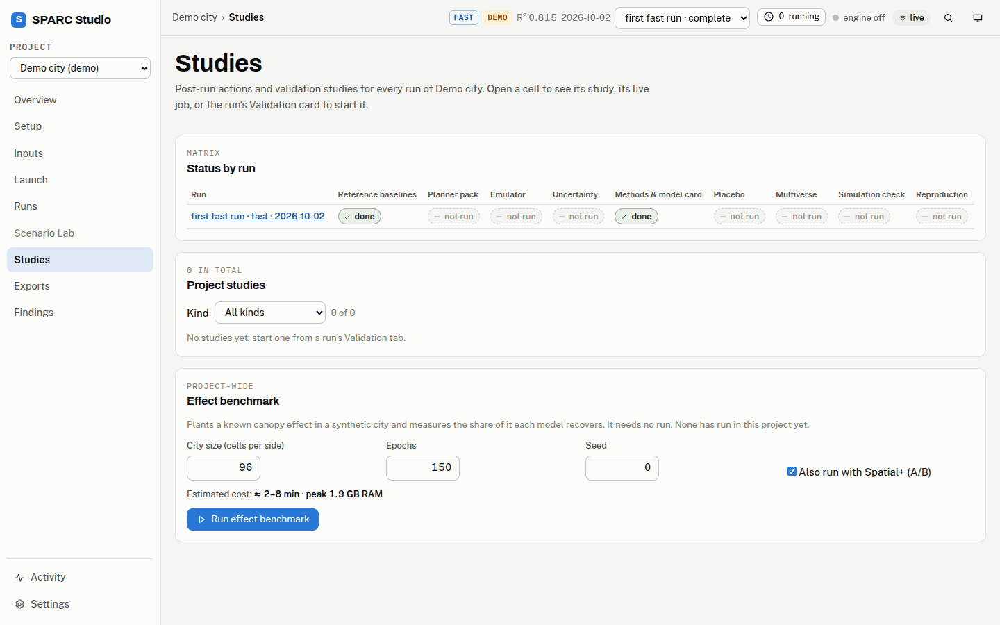

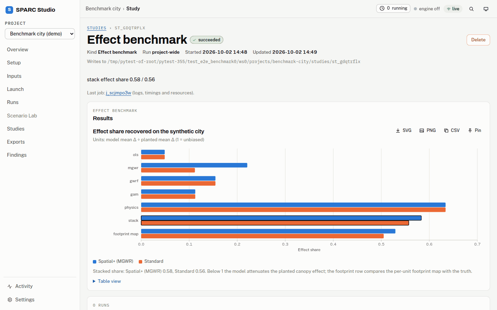

Imported study folders are read-only: they cannot be resumed or continued, and deleting them never deletes their files.

---

## 9. Settings, thread budget and memory

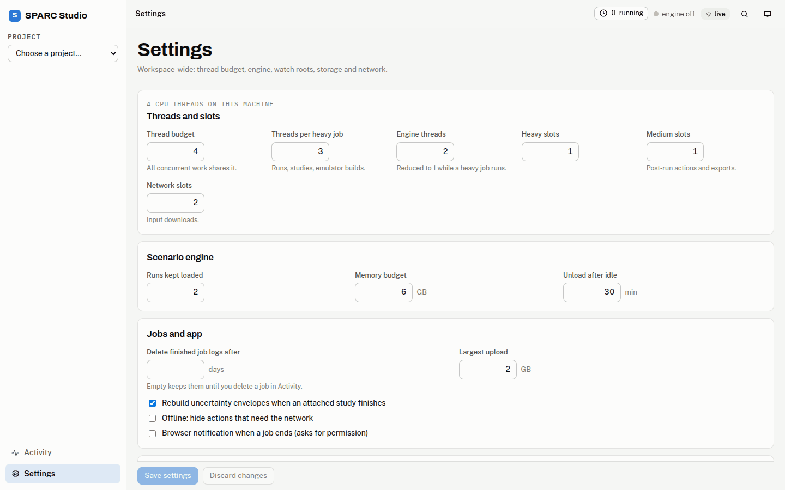

| Setting | Default | Notes |
|---|---|---|
| Thread budget | number of CPU threads | Everything running at once shares it |
| Threads per heavy job | CPU threads − 1 | Runs, studies, emulator builds |
| Engine threads | 2 | Reduced to 1 while a heavy job runs |
| Heavy · medium · network slots | 1 · 1 · 2 | How many jobs of each lane run at once; post-run actions and exports are medium, downloads network |
| Runs kept loaded | 2 | Scenario engine LRU |
| Memory budget | 40% of RAM, at most 6 GB | For loaded engines; above it the least recently used run is unloaded |
| Unload after idle | 30 min | The engine process exits when idle this long |
| Rebuild uncertainty when an attached study finishes | on | |
| Watch roots | none | Folders scanned for CLI runs |
| Largest upload | 2 GB | |
| Delete finished job logs after | never | |
| Offline | off | Hides every action that needs the network |
| Browser notifications | off | |

**Why a thread budget.** Model fits slow down badly when too many threads compete (fits measured at 82–368 s instead of 1 s). Studio therefore gives each worker an explicit thread count and refuses settings where heavy-job threads plus engine threads exceed the budget by more than one. Leave the defaults unless you know the machine is shared.

**Memory.** Launch and the engine check memory before starting: a job or engine load whose estimate plus 1 GB exceeds the memory available (after other live jobs) is refused with options to stop a job or unload a run. The Resources tab of Mission Control warns above 80% of memory. If a run keeps dying out of memory, use **Coarse 60 m**, close other heavy jobs, or lower "Runs kept loaded".

**Storage** (Settings → Storage) shows the workspace size, free disk, caches and per-run and per-study sizes, with guarded deletes. Studio broadcasts a warning when free disk falls below 2 GB.

**Network check** tests the hosts the input downloads need, and caches the answer for ten minutes.

---

## 10. Troubleshooting

### `sparc studio` says SPARC Studio is not available

```text
SPARC Studio is not available (No module named 'fastapi').
Install it with:  pip install "sparc[studio]"
```

Install the extra into the same Python environment as `sparc` (exit status 2 means exactly this).

### The port is busy, or another Studio holds the workspace

A busy port falls back to a free one, and the printed link has the real port. If the terminal says another SPARC Studio process holds the workspace but does not answer, a server for that workspace is still starting (a long `--reindex`) or hung: wait, or stop that process and start again. Studio never starts two servers on one workspace and never kills the other one.

### The browser shows 401, or "Frontend not built"

- **401**: the session cookie is missing or from an earlier launch. Open the link the terminal printed (it carries the new token).
- **"Frontend not built — run `npm --prefix studio-web run build`"**: you are running from a source checkout whose built web app is missing. Rebuild it (see [`DEVELOPING.md`](DEVELOPING.md)) or install a released package.

### A job ended "likely out of memory" or "possibly out of memory"

The worker was killed by the operating system while it used most of the memory. Resume it once other heavy jobs have finished and loaded runs are unloaded (the engine's memory dialog offers to unload them; Settings → Scenario engine → "Runs kept loaded" keeps fewer), or launch **Coarse 60 m**. Simulation checks and multiverses run several child fits at once: lower their workers.

### A run is interrupted

The process vanished (server killed, sleep, out of memory). Open the run: the checkpoint card says what is saved and whether it matches the launch snapshot, and **Resume** reuses it. A run interrupted before its first checkpoint (before S2–S3 finished) has nothing to reuse, so a resume starts again from S0.

### Resume refuses, or would refit everything

- **Resume is refused** in three cases, and the dialog says which: the run has no launch snapshot (it was made with the command line, not launched from Studio: launch a new run of the project from **Launch**), the run is already complete, or a job is still running on it. **Resume with current project config** is also refused for a run that belongs to no project, or when the current project config does not load.
- **"the checkpoint does not match the launch snapshot (… changed): a resume refits"** means the data file or the pipeline code changed since the run was launched; the card names which. A resume still runs, but reuses nothing. If the code changed because you upgraded, see the next item. To refit on purpose with your edited project config, use **Resume with current project config**, which shows its impact first.

### Incompatible checkpoints and stale results

- **Checkpoints from before this release cannot be resumed.** This release changed the pipeline code that a checkpoint's fingerprint covers (see [`RELEASE_NOTES.md`](RELEASE_NOTES.md)). Such runs still open: every output stays viewable and the Lab can still load their checkpoints. They have no `checkpoint.json`, so the engine cannot tell which code wrote them (`code_match: null`).
- **Code changed since a checkpoint was saved**: for checkpoints written by this release, a later change of the pipeline code makes the engine report `code_match: false`; the Lab still loads the checkpoint, a resume refits (see above), and full-model results computed before the change are marked **out of date**.
- **"Model not available for this run"** (engine *incompatible*): the saved models cannot be loaded by this version (a class it pickled no longer exists). The Lab offers **Refit S2/S3**, which re-runs the run from its launch snapshot as a new run; meanwhile you can work with quick estimates only.
- **Out-of-date results** (a banner on a result) were computed before the run's saved models or the pipeline code changed. They stay readable; **Run full model again** to refresh them.
- **Untrusted checkpoint**: an imported run's checkpoint is not loaded until you confirm it is yours ([J10](#j10--bring-existing-work-in)).

### Input downloads fail

- Each input card shows the hosts it needs and their reachability (**Check hosts**). Settings has a network check for all of them.
- Downloads retry on their own (the job shows a `network.retry` warning per retry). A failed download can be retried from Mission Control.
- The ISD station picker never downloads during a request: if the station list is not cached, use **Fetch station list** first.
- Everything downloaded is cached in `<workspace>/cache/` and reused by every project.
- **Offline mode** (Settings) hides every action that needs the network, for air-gapped machines. Runs, the Lab, studies and exports work offline once the inputs are in place.

### The Lab says "No quick estimate yet", or the map is hatched

The run has no quick estimate (`no_emulator`): **Build quick estimate** (in the Lab's quick-estimate pane, or the **Quick estimate** card under Independent checks). Hatching ("Rough estimate here") means the quick estimate is unreliable at that scale: use **Run full model**.

### The index looks wrong

If runs, studies or exports are missing after a crash or after copying a workspace, rebuild the index from the files:

```bash
# runnable
WS="${SPARC_STUDIO_HOME:-$HOME/sparc-studio}"
sparc studio --reindex --no-browser --port 0 --token reindex &
for i in $(seq 1 120); do
  URL=$(python -c 'import json, sys; print(json.load(open(sys.argv[1]))["url"])' "$WS/studio.lock.json" 2>/dev/null) \
    && curl -sf "$URL/api/health" > /dev/null && break
  sleep 1
done
curl -fsS -H "Authorization: Bearer reindex" "$URL/api/projects"; echo
curl -fsS -X POST -H "Authorization: Bearer reindex" -H "Content-Type: application/json" -d '{}' "$URL/api/shutdown"; echo
wait
```

(Or simply `sparc studio --reindex`.) Settings, config history, saved regions and uploaded selection masks are not in the files and are kept only if the database survives.

### Where the logs are

- A job: Mission Control → Logs, or `<workspace>/jobs/<job id>/` (`events.jsonl`, `stdout.log`, `stderr.log`, `result.json`). **Copy diagnostics** collects what a bug report needs.
- The scenario engine: `<workspace>/engine/host.log`.
- The server: the terminal (`--log-level debug` for more).

### Known limitations of this release

- The legacy desktop app (`sparc-desktop/`, the `sparc/server/` API) is unchanged and remains available until Studio reaches parity with it.
- The ETA of a resumed run does not discount cached stages at first ([§5](#progress-and-eta)).
- Brush strokes saved in an earlier session reopen as per-cell edits; they can be removed but not repainted.
- Windows and macOS run the self-check and the Studio test suites in CI; the slow nightly suites run on Linux only.
